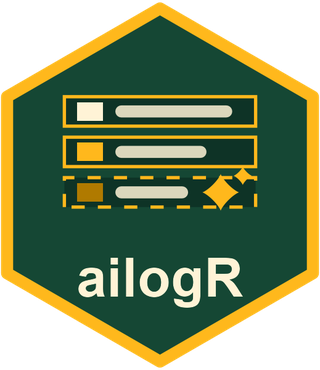

{.hex fig-alt="ailogR hex sticker"}

::: {.project-meta}
**Status:** In development · public repository · MIT<br>
**Stack:** R (base and utils only)<br>
**Code:** [github.com/CRASR/ailogR](https://github.com/CRASR/ailogR)
:::

## What it does

ailogR records AI use as rows in a plain CSV file in a project's `ai-use/` folder, quickly enough to do at the end of every work session. Each entry records whether an error in the AI output would be obvious, caught by routine checks, or could pass silently into results, and the silent ones need a check that could catch them. From the log, ailogR finds gaps and drafts the AI-use statement for a paper.

The package is general. Projects that follow our [AI-use policy](https://github.com/CRASR/ai-use/blob/main/POLICY.md) can say so in their statement, and [AI in our research](../ai.qmd) explains how we use AI.

## Highlights

- `log_ai()` asks up to six questions and offers your last tool and research stage first
- Detail scales with risk: `checkable` and `silent` entries also record how the output was checked
- Coding agents and chat apps can draft entries for you to review with `edit_ai_log()`
- Research stages follow the AID Framework (Weaver 2024) plus CRediT, so entries map onto published statement formats

## Get it

```r
# install.packages("remotes")
remotes::install_github("CRASR/ailogR")

library(ailogR)
create_ai_log()        # once per project: makes ai-use/
log_ai()               # after a work session where AI output stayed in the work
draft_ai_statement()   # draft the AI-use statement
```
