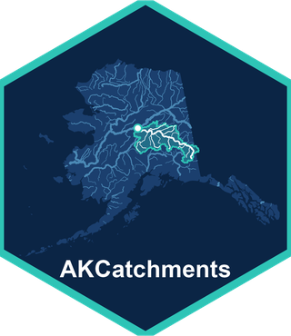

{.hex fig-alt="AKCatchments hex sticker"}

::: {.project-meta}
**Status:** Alpha · public repository · MIT<br>
**Stack:** R · sf · terra · WhiteboxTools<br>
**Code:** [github.com/AKRiversLab/AKCatchments](https://github.com/AKRiversLab/AKCatchments)<br>
**Partner:** [AKRivers lab](../collaborations.qmd#category=AKRivers%20lab) (Jeff Muehlbauer, UAF)<br>
**Our role:** Lead developer and maintainer
:::

## What it does

AKCatchments delineates and generates catchment-scale information for streams in Alaska.

## Highlights

- Coming soon!

## Get it

```r
# install.packages("remotes")
remotes::install_github("AKRiversLab/AKCatchments")
whitebox::install_whitebox()   # WhiteboxTools binary for flow routing, once
```

The [README](https://github.com/AKRiversLab/AKCatchments#readme) covers the workflow, the download cache, and each data layer.
